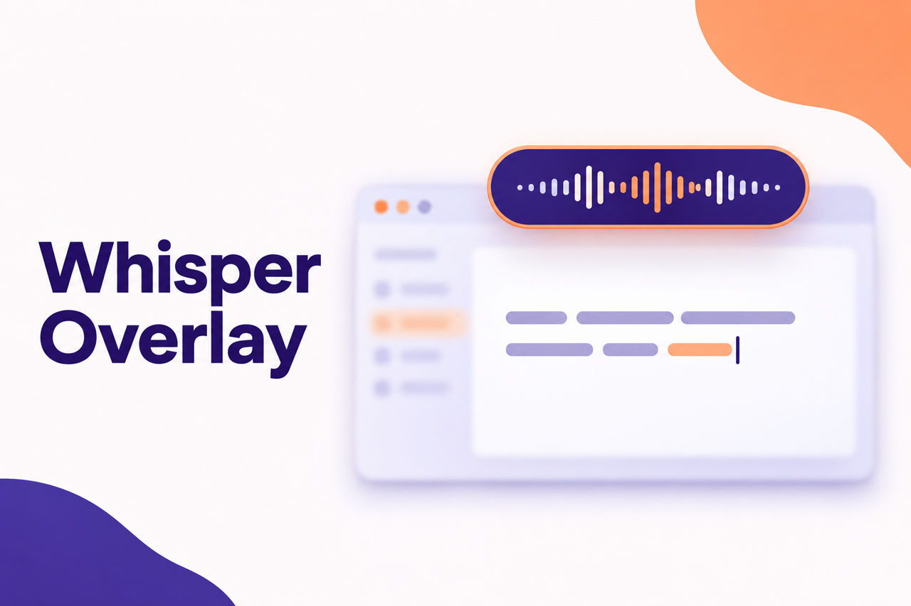
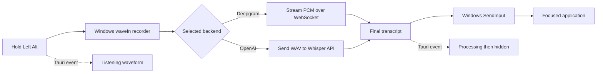

<div align="center">

# Whisper Overlay

**A Windows push-to-talk overlay that records speech, transcribes it, and types into the active application.**

[](https://github.com/Msparihar/whisper-overlay/releases/latest)
[](LICENSE)
[](#quickstart)



</div>

Whisper Overlay is a Tauri v2 desktop app for Windows. Hold **Left Alt** to record, release it to transcribe, and the result is inserted into the application that has focus. A compact waveform shows the listening and processing states without taking focus from your work.

<div align="center">
  
  <br>
  <sub>Real React overlay rendered with mocked Tauri events; no product UI was recreated for this capture.</sub>
</div>

## Features

| Input | Transcription | Desktop behavior |
|---|---|---|
| Hold Left Alt to record and release to submit | Deepgram Nova-3 streaming or OpenAI Whisper batch | Types Unicode text into the focused Windows application |
| 16 kHz mono capture through the Windows waveIn API | English, Hindi, or automatic language detection | 350×56 always-on-top waveform that does not appear in the taskbar |
| Select any detected microphone from the tray | Developer vocabulary hints are included for both backends | Gray, green, and orange tray states for idle, listening, and processing |

## How it works



Deepgram receives audio chunks while the key is held. OpenAI receives the buffered recording after release. Recordings shorter than 0.3 seconds are ignored.

## Quickstart

1. Download the latest Windows executable from [Releases](https://github.com/Msparihar/whisper-overlay/releases/latest).
2. Set at least one API key in the environment or in `~/.env.local`:

   ```dotenv
   DEEPGRAM_API_KEY=your_key_here
   OPENAI_API_KEY=your_key_here
   ```

3. Run the executable. The app starts in the system tray.
4. Hold **Left Alt**, speak, then release. Right-click the tray icon to change the backend, microphone, or language.

If both keys are present, Deepgram is selected at startup. If only `OPENAI_API_KEY` is present, OpenAI Whisper is selected.

## Build from source

Install [Rust](https://rustup.rs/), [Bun](https://bun.sh/), and the Tauri prerequisites for Windows, then run:

```bash
git clone https://github.com/Msparihar/whisper-overlay.git
cd whisper-overlay
bun install
bun tauri build
```

The release executable is written to `src-tauri/target/release/app.exe`. Windows 10/11 requires WebView2; it is included with Windows 11.

## Configuration

Whisper Overlay has no configuration file. API keys are read at startup, while tray choices apply for the current run.

| Setting | Where to set it | Values / behavior |
|---|---|---|
| `DEEPGRAM_API_KEY` | Environment or `~/.env.local` | Enables Deepgram Nova-3 and makes it the default when present |
| `OPENAI_API_KEY` | Environment or `~/.env.local` | Enables the OpenAI `whisper-1` backend |
| Backend | Tray menu | Deepgram Nova-3 or Whisper; switching requires that backend's key |
| Microphone | Tray menu | Any input reported by the Windows waveIn API; defaults to Windows `WAVE_MAPPER` |
| Language | Tray menu | English (`en`), Hindi (`hi`), or auto-detect (`auto`); defaults to English |
| Push-to-talk key | Fixed | Left Alt |

## Troubleshooting

| Problem | Check |
|---|---|
| The app exits at startup | Set `DEEPGRAM_API_KEY` or `OPENAI_API_KEY` before launching. At least one is required. |
| Left Alt does not start recording | Allow microphone access in Windows privacy settings and confirm an input device is available. |
| The overlay reacts but no text appears | Make sure the recording is longer than 0.3 seconds, the selected backend has a key, and the destination app still has focus. |
| Deepgram returns no transcript | Try the OpenAI backend from the tray and verify the Deepgram key and network connection. |
| The wrong microphone or language is used | Select the correct entry from the tray before the next recording; tray choices are not persisted across restarts. |

## Roadmap and contributing

Roadmap work is tracked in [GitHub Issues](https://github.com/Msparihar/whisper-overlay/issues). Contributions are welcome through an issue or pull request; keep changes focused on Windows, Tauri v2, and the existing push-to-talk flow.

## License

MIT — see [LICENSE](LICENSE).
